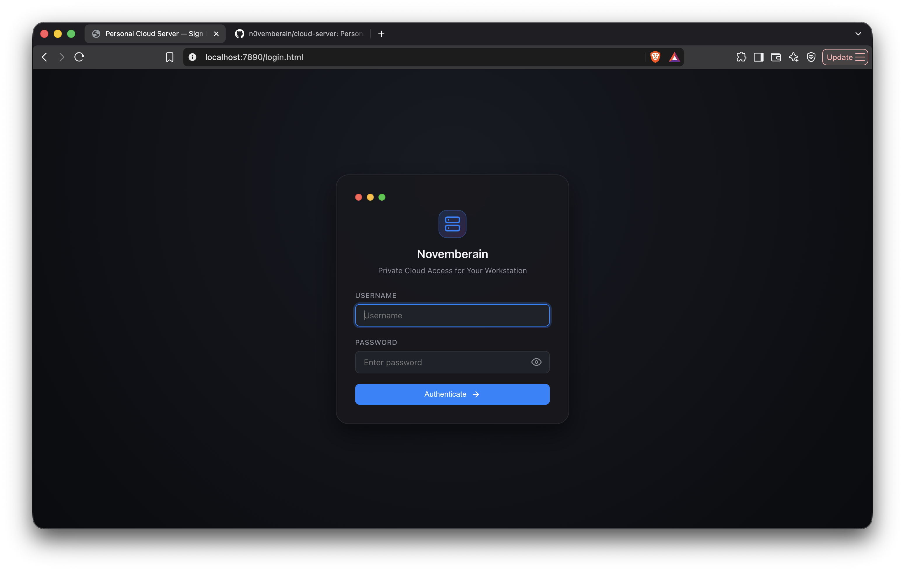
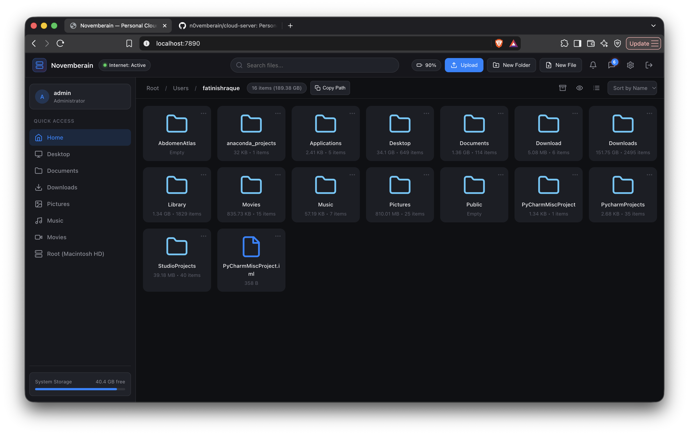
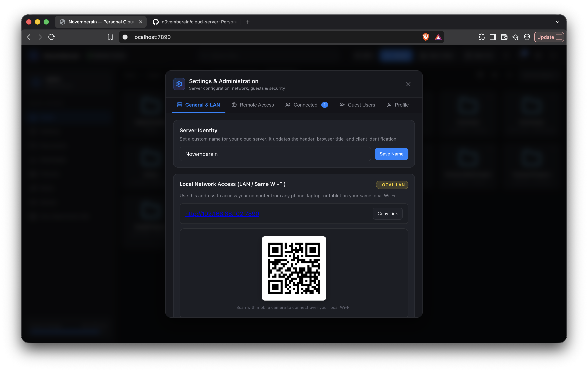
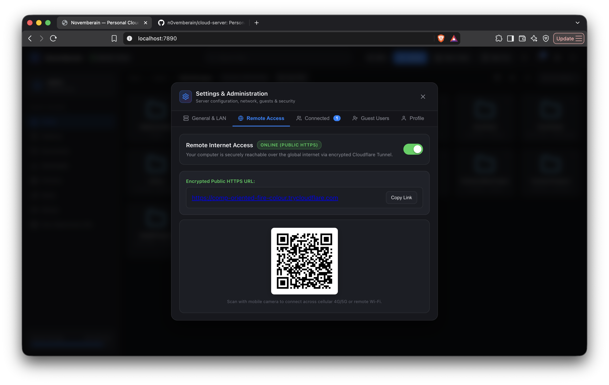
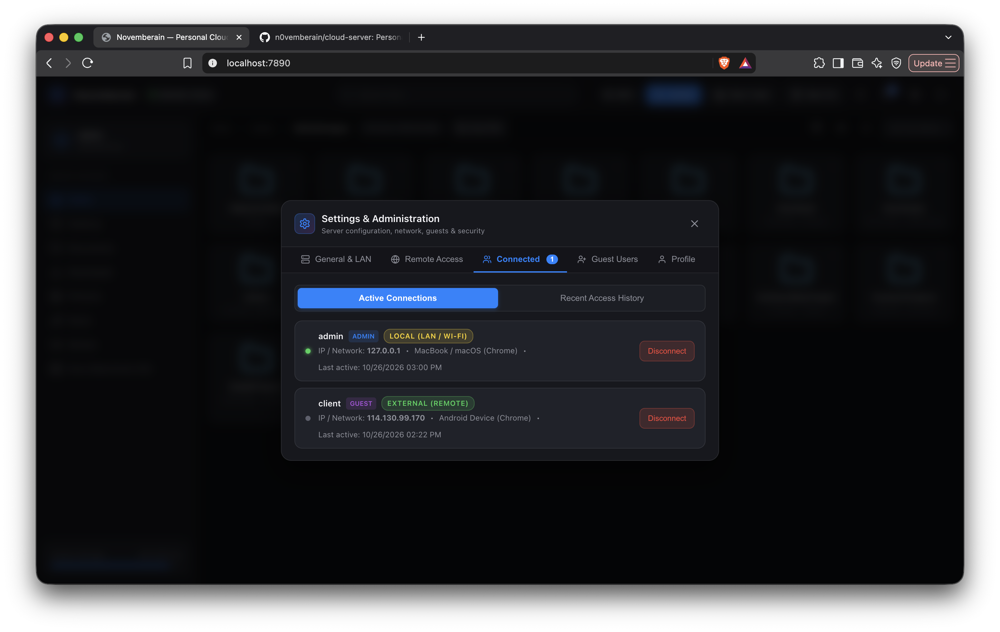
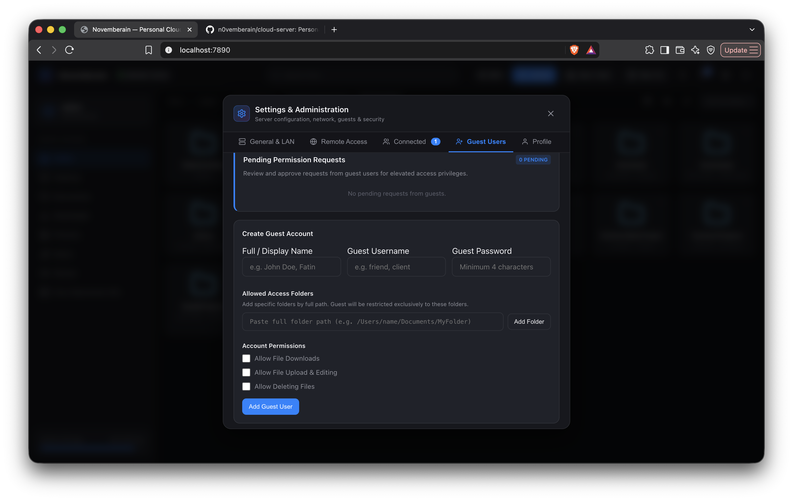
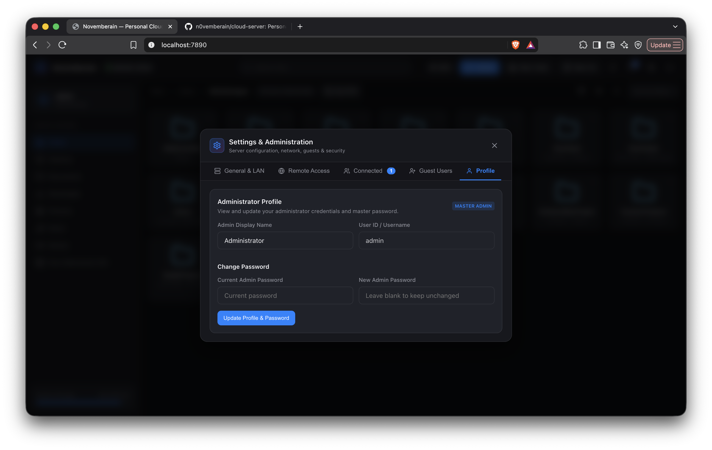
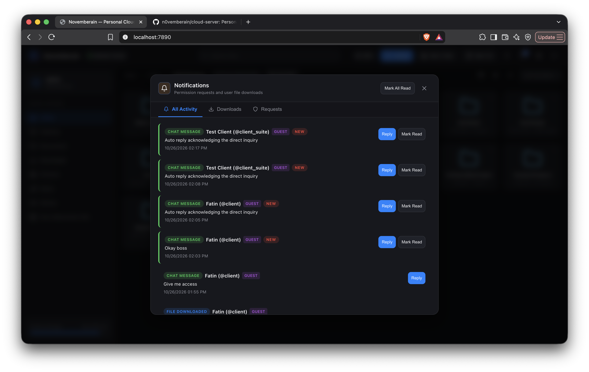
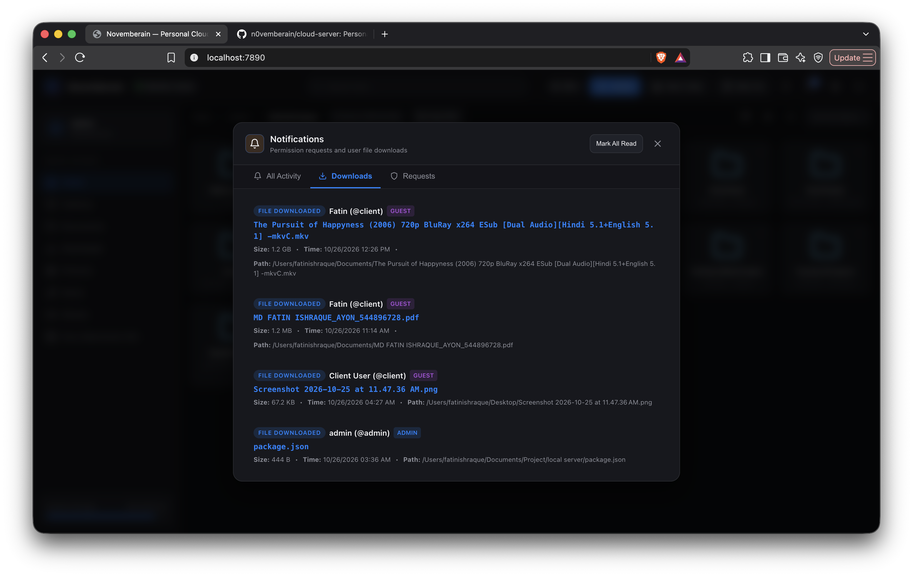
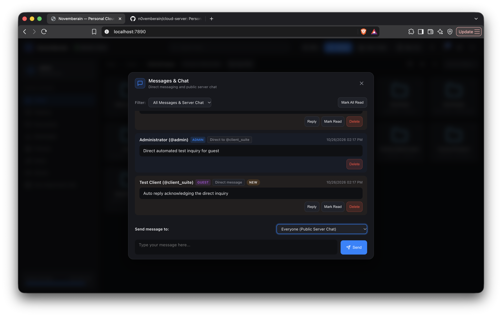

# Personal Cloud Server

A lightweight, self-hosted personal cloud that turns your computer into a private cloud storage server. Access, stream, edit, upload, and download your files remotely from any smartphone, tablet, or PC over your local Wi-Fi or across the internet with zero router configuration.

---

## What Can You Do With It?

- **Access Your Files Anywhere**: Connect securely over local Wi-Fi or across the internet via encrypted Cloudflare Tunnels (no public IP or router port forwarding needed).
- **Stream & Preview Media**: Stream video and audio directly in your browser, view photos, and read documents without downloading them first.
- **In-Browser Code & Text Editor**: View and edit scripts, code, and text files directly from your mobile device or laptop with instant saving.
- **Multi-User Access & Granular Permissions**: Create guest accounts for clients, friends, or family with access restricted to specific folders and permissions (download, upload, edit, delete).
- **Download Tracking & Notifications**: Monitor who downloads what in real time with detailed file auditing and approval workflows for permission requests.
- **Built-in Chat & Messaging**: Send direct messages between admin and guest users, with automatic mark-as-read on reply.
- **One-Click Session Management**: View all connected devices and disconnect any session immediately.

---

## Interface Preview





















---

## Quick Start

### 1. Clone & Install
```bash
git clone https://github.com/n0vemberain/cloud-server.git
cd cloud-server/LocalServerCodebase
npm install
```

### 2. Start the Server

- **macOS / Linux**:
  ```bash
  ./start.sh
  ```
  *(or `npm start`)*

- **Windows**:
  ```cmd
  start.bat
  ```

### 3. Log In

Open the URL shown in the terminal (Local URL or Remote URL) or scan the terminal QR code from your mobile device:

| Field | Default Value | Notes |
|---|---|---|
| **Username** | `admin` | Default master administrator username |
| **Password** | `mac1234` | Change anytime in Settings -> Security |

---

## Tech Stack

- **Backend**: Node.js, Express.js
- **Tunneling**: Cloudflare Tunnel (`cloudflared`)
- **Frontend**: Vanilla HTML5, CSS3, JavaScript (responsive glassmorphism UI)
- **Security**: HMAC-SHA256 session tokens, instant session revocation, directory sandboxing

---

## Contact & Support

- **Author**: Fatin Ishraque
- **Email**: [fatinishraque2@gmail.com](mailto:fatinishraque2@gmail.com)
- **GitHub**: [github.com/n0vemberain](https://github.com/n0vemberain)
- **Repository**: [github.com/n0vemberain/cloud-server](https://github.com/n0vemberain/cloud-server)
